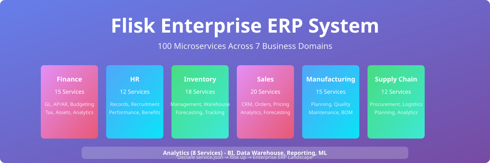
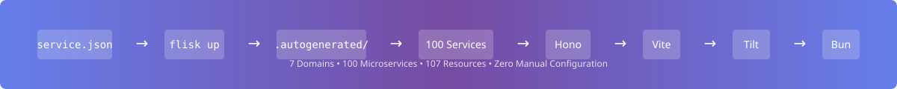
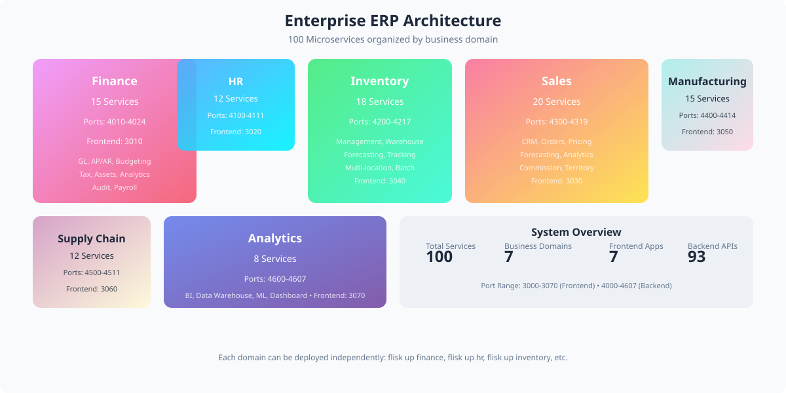

<!-- markdownlint-disable MD013 MD033 MD041 -->

[](https://github.com/tdk-landscape/tdk-cli-core)

<p align="center">
  
</p>

<p align="center">
  <a href="#run-it">Run it</a>
  &nbsp;&nbsp;/&nbsp;&nbsp;
  <a href="#the-landscape">Explore the landscape</a>
  &nbsp;&nbsp;/&nbsp;&nbsp;
  <a href="#generation">Understand generation</a>
  &nbsp;&nbsp;/&nbsp;&nbsp;
  <a href="#sales-pitch-deck">Sales Pitch Deck</a>
  &nbsp;&nbsp;/&nbsp;&nbsp;
  <a href="#demo-walkthrough">Demo Walkthrough</a>
  &nbsp;&nbsp;/&nbsp;&nbsp;
  <a href="https://github.com/tdk-landscape/tdk-cli-core">TDK CLI</a>
</p>

<br>

## Enterprise ERP System in One Clone

This repository is a production-grade demonstration of the TDK **Project-Stack-Resource (PSR)** model engineered specifically for **Enterprise Resource Planning (ERP)** with **100 microservices** across 7 business domains: Finance, HR, Inventory, Sales, Manufacturing, Supply Chain, and Analytics.

You declare your enterprise services in simple `service.json` manifests. TDK automatically discovers the landscape, resolves cross-stack dependencies, allocates dynamic port bindings, and generates local Docker, Vite, environment variables, and TypeScript plumbing inside `.autogenerated/`.

<p align="center">
  
</p>

> ⭐ **This project runs on [TDK CLI](https://github.com/tdk-landscape/tdk-cli-core).** If it saves you time, [star tdk-cli-core on GitHub](https://github.com/tdk-landscape/tdk-cli-core) so other developers can find it.

---

## Run It

### Prerequisites

- [Docker](https://docs.docker.com/get-docker/) is running.
- [Tilt](https://docs.tilt.dev/install.html) is installed.
- [Bun 1.2+](https://bun.sh/docs/installation) is installed.
- [TDK CLI](https://github.com/tdk-landscape/tdk-cli-core#installation) is available as `tdk`.

```bash
git clone https://github.com/tdk-landscape/tdk-erp-system.git
cd tdk-erp-system

# Spin up the entire Enterprise ERP landscape
tdk up
```

TDK discovers all 7 stacks and their 100 underlying resources, allocates non-conflicting ports, and starts the containerized execution graph.

```bash
# Start a specific domain stack (e.g. Finance, HR, Sales, etc.)
tdk up finance
tdk up hr
tdk up inventory
tdk up sales
tdk up manufacturing
tdk up supply_chain
tdk up analytics

# Inspect all running enterprise services
tdk status

# Stop the entire landscape cleanly
tdk down
```

---

## The Landscape

<p align="center">
  
</p>

(Full service tables and details preserved from original README.)
